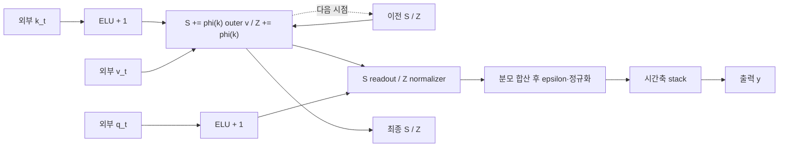

# Linear Transformer

**복원 범위: ELU+1 feature map을 사용하는 recurrent linear-attention.** 해당 범위에서 검증을 마친 YAML과 복원 코드입니다.

[YAML](representation.yaml) · [복원 코드](reconstructed.py) · [출처·확인 범위](provenance.json)

## 구조도

q/k/v는 외부 입력입니다. S/Z는 제자리 갱신하며, 갱신한 상태로 현재 시점의 출력을 계산합니다. 주요 계산을 묶어 보여주는 요약도이며, 세부 연산과 연결은 위 YAML과 코드를 기준으로 확인합니다.

## YAML이 표현하는 내용

`representation_version: 0.3-candidate.1` · 진입점 `entry`.

q/k feature map → S/Z 누적 갱신 → query readout → 분모 합산 후 epsilon → 정규화.

| YAML에서 볼 곳 | 복원 코드에서의 구현 |
|---|---|
| `entry`, `iterate.scan` | 시간축 순회 |
| `elementwise_branch`, `f_q_elu`, `f_k_elu` | `ElementwiseBranch`의 primitive ELU 분해와 +1 |
| `f_outer`, `f_s_next`, `f_z_next` | key/value outer product 및 `s.add_`, `z.add_` |
| `f_den_sum`, `f_den_eps`, `f_read_sum`, `f_y` | 누적 상태 readout과 epsilon=1e-6 정규화 |

YAML은 연산·연결·속성·공유·상태를 기술합니다. 학습된 가중치나 실행 fixture를 저장하는 파일은 아닙니다. [공통 읽기 안내](../../docs/representation-guide.md)를 함께 참고하세요.

## 입력과 출력

| 방향 | 포트 | Shape |
|---|---|---|
| 입력 | `q` | `['B', 'T', 'H', 3]` |
| 입력 | `k` | `['B', 'T', 'H', 3]` |
| 입력 | `v` | `['B', 'T', 'H', 5]` |
| 입력 | `s` | `['B', 'H', 3, 5]` |
| 입력 | `z` | `['B', 'H', 3]` |
| 출력 | `y` | `['B', 'T', 'H', 5]` |
| 출력 | `s_final` | `['B', 'H', 3, 5]` |
| 출력 | `z_final` | `['B', 'H', 3]` |

## 복원 코드 사용 조건

`model = create_unit_c().eval()` → `y, s_final, z_final = model(q, k, v, s, z)`.

별도 Parameter/Buffer가 없습니다. q/k/v는 projection을 마친 외부 입력입니다. s/z는 호출자가 제공하는 누적 상태로 **제자리 갱신**되며 반환 상태는 입력과 같은 객체입니다. 후속 구간에 그대로 전달할 수 있습니다.

코드의 import·생성·forward 이름은 위 계약을 따릅니다. 원본과 수치 비교하려면 입력, 초기 상태, Parameter/Buffer 값, dtype과 eval 조건을 동일하게 맞춰야 합니다. 저장된 검증 환경은 CPU·PyTorch 2.2.1입니다.

## 확인한 결과와 범위

네 fixture에서 출력·prefix 상태 갱신·반환 alias·입력 불변성·구간 연결을 검사했습니다. 재검증 기록 71개가 일치하고 최대 절대 오차 약 2.38e-7입니다.

해당 평가 기준을 통과했습니다. stateless wrapper Module identity는 이 평가에서 제외했으므로 원본 Common Schema의 identity BLOCKED를 해소한 것은 아닙니다. 전체 Transformer와 projection은 포함하지 않습니다.

이 폴더는 최신 사용 자료이며 상세 실험 로그·검사기·fixture 묶음은 포함하지 않습니다. 검증 근거의 연구 작업 공간 기록은 provenance.json에 있습니다.

[전체 모델 목록](../../README.md)

## 관련 관계

- [Transformer → Linear Transformer](../../relations/tr_037.yaml) — A · tr_037
- [Linear Transformer → Performer](../../relations/tr_039.yaml) — I? · tr_039

[관계용 별도 표현과 계약](genealogy/README.md)
