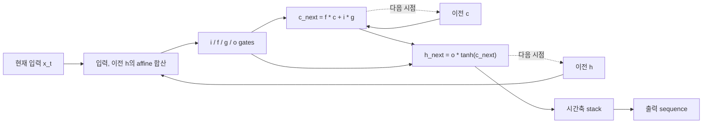

# LSTM

입력 크기 4, 은닉 크기 5의 단방향 LSTM recurrent core, T≥1.

[YAML](representation.yaml) / [복원 코드](reconstructed.py) / [출처, 확인 범위](provenance.json)

## 구조도

한 시점의 계산을 시간축으로 반복하며 같은 파라미터를 재사용합니다. 최종 h/c도 반환합니다. 주요 계산을 묶어 보여주는 요약도이며, 세부 연산과 연결은 위 YAML과 코드를 기준으로 확인합니다.

## YAML이 표현하는 내용

`representation_version: 0.3-candidate.1`, 진입점 `root`.

입력, 이전 h의 affine → i/f/g/o gate → c 갱신 → h 갱신 → 시간축 stack.

| YAML에서 볼 곳 | 복원 코드에서의 구현 |
|---|---|
| `root`, `iterate.scan` | `forward`의 시간축 반복 |
| `affine_a`, `affine_b`, `partition` | 두 `F.linear`와 `[5,5,5,5]` gate 분할 |
| `gate_a`…`gate_d`, `retain`, `write`, `update`, `expose` | sigmoid/tanh와 cell, hidden 갱신 |
| `parameters.p0`…`p3`, scan carry | 모든 시점에서 동일 Parameter와 이전 h/c 사용 |

YAML은 연산과 연결, 속성, 공유, 상태를 기술합니다. 학습된 가중치나 실행 fixture를 저장하는 파일은 아닙니다. [공통 읽기 안내](../../docs/representation-guide.md)를 함께 참고하세요.

## 입력과 출력

| 방향 | 포트 | Shape |
|---|---|---|
| 입력 | `x` | `['B', 'T', 4]` |
| 입력 | `h0` | `['B', 5]` |
| 입력 | `c0` | `['B', 5]` |
| 출력 | `y` | `['B', 'T', 5]` |
| 출력 | `hn` | `['B', 5]` |
| 출력 | `cn` | `['B', 5]` |

## 복원 코드 사용 조건

`model = create_recurrent_tensor_region(p0, p1, p2, p3)` → `y, hn, cn = model.forward(x, h0, c0)`.

p0=[20,4] 입력 weight, p1=[20,5] recurrent weight, p2/p3=[20] bias를 외부에서 전달합니다. 이 클래스는 일반 Python 객체로, `nn.Module`의 `.eval()`이나 `model(...)` 호출을 전제로 하지 않습니다.

| YAML Parameter | Shape |
|---|---|
| `p0` | `[20, 4]` |
| `p1` | `[20, 5]` |
| `p2` | `[20]` |
| `p3` | `[20]` |

[전체 모델 목록](../../README.md)

## 관련 관계

유형과 대응 범위는 [관계 안내](../../docs/genealogy-guide.md)를 참고합니다. `?`는 추론 관계입니다.

- [Simple RNN → LSTM](../../relations/tr_003.yaml) — A, tr_003
- [LSTM → Seq2Seq](../../relations/tr_004.yaml) — C, tr_004
- [LSTM → LSTMN](../../relations/tr_010.yaml) — A, tr_010
- [LSTM → GNMT](../../relations/tr_013.yaml) — A, tr_013
- [LSTM → RNN Encoder–Decoder / GRU](../../relations/tr_073.yaml) — I, tr_073
