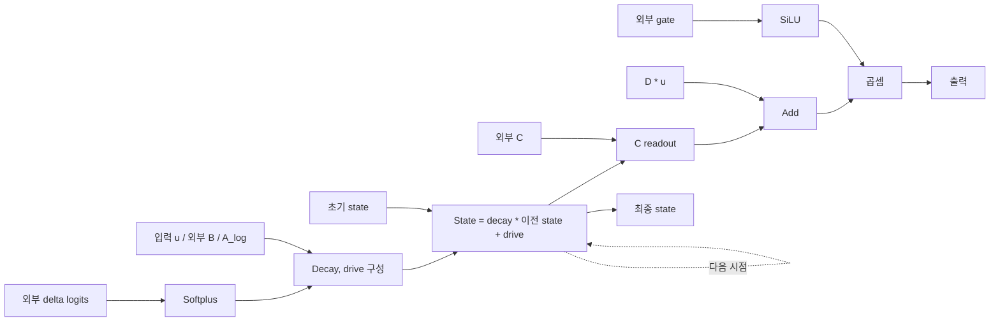

# Mamba

Mamba-1 selective-scan core, channels=3, state_size=2.

[YAML](representation.yaml) / [복원 코드](reconstructed.py) / [출처, 확인 범위](provenance.json)

## 구조도

B/C, delta logits, gate는 외부에서 공급됩니다. 시점별 상태 갱신 뒤 readout, D skip, gate를 적용합니다. 주요 계산을 묶어 보여주는 요약도이며, 세부 연산과 연결은 위 YAML과 코드를 기준으로 확인합니다.

## YAML이 표현하는 내용

`representation_version: 0.3-candidate.1`, 진입점 `entry`.

delta softplus → decay, drive 구성 → state recurrence, readout → D skip → SiLU gate.

| YAML에서 볼 곳 | 복원 코드에서의 구현 |
|---|---|
| `delta_positive`, `rates_exp`, `rates_negative`, `decay` | softplus(delta), -exp(A_log), 시간별 decay |
| `discrete_B`, `drive` | 입력과 B를 이용한 state drive |
| `recurrence.scan`, `step` | 시간별 retained state + drive 및 C readout |
| `skip`, `pre_gate`, `gate_activation`, `gated` | D skip과 SiLU gate |

YAML은 연산과 연결, 속성, 공유, 상태를 기술합니다. 학습된 가중치나 실행 fixture를 저장하는 파일은 아닙니다. [공통 읽기 안내](../../docs/representation-guide.md)를 함께 참고하세요.

## 입력과 출력

| 방향 | 포트 | Shape |
|---|---|---|
| 입력 | `u` | `['Batch', 3, 'Time']` |
| 입력 | `gate` | `['Batch', 3, 'Time']` |
| 입력 | `delta_logits` | `['Batch', 'Time', 3]` |
| 입력 | `B` | `['Batch', 'Time', 2]` |
| 입력 | `C` | `['Batch', 'Time', 2]` |
| 입력 | `initial_state` | `['Batch', 3, 2]` |
| 출력 | `output` | `['Batch', 3, 'Time']` |
| 출력 | `final_state` | `['Batch', 3, 2]` |

## 복원 코드 사용 조건

`model = create_selective_state_subunit().eval()` → `output, final_state = model(u, gate, delta_logits, B, C, initial_state)`.

p_A_log=[3,2], p_D=[3]의 두 Parameter를 외부 값으로 주입합니다. B/C, delta logits, gate는 상위 경로가 계산해 넘기는 입력입니다. 생성자의 0은 비교용으로 사용할 실제 파라미터가 아닙니다.

| YAML Parameter | Shape |
|---|---|
| `p_A_log` | `[3, 2]` |
| `p_D` | `[3]` |

## 관련 관계

유형과 대응 범위는 [관계 안내](../../docs/genealogy-guide.md)를 참고합니다. `?`는 추론 관계입니다.

- [S4 → Mamba](../../relations/tr_061.yaml) — A, tr_061
- [H3 → Mamba](../../relations/tr_062.yaml) — A, tr_062
- [Mamba → Mamba-2 / SSD](../../relations/tr_063.yaml) — A, tr_063
- [Mamba → Jamba](../../relations/tr_064.yaml) — C, tr_064
- [Mamba → TTT](../../relations/tr_067.yaml) — P, tr_067
