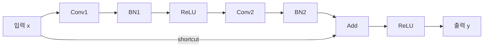

# ResNet

입력을 그대로 더하는 shortcut을 가진 채널 64의 BasicBlock.

[YAML](representation.yaml) / [복원 코드](reconstructed.py) / [출처, 확인 범위](provenance.json)

## 구조도

두 ReLU 호출은 같은 객체를 공유합니다. Add는 main 결과를 제자리 갱신합니다. 주요 계산을 묶어 보여주는 요약도이며, 세부 연산과 연결은 위 YAML과 코드를 기준으로 확인합니다.

## YAML이 표현하는 내용

`representation_version: 0.2`, 진입점 `block`.

Conv → BN → ReLU → Conv → BN → 입력과 합산 → ReLU.

| YAML에서 볼 곳 | 복원 코드에서의 구현 |
|---|---|
| `block`, `main` | `BasicBlock.forward`의 residual 경로 |
| `conv1`, `bn1`, `conv2`, `bn2` | 두 Conv2d와 두 BatchNorm2d |
| `relu`, `activation` / `resource` | 두 번 호출하지만 같은 ReLU 객체를 공유 |
| `merge`의 `inplace`, `target` | main 결과에 `add_(x)` 수행 |

YAML은 연산과 연결, 속성, 공유, 상태를 기술합니다. 학습된 가중치나 실행 fixture를 저장하는 파일은 아닙니다. [공통 읽기 안내](../README.md)를 함께 참고하세요.

## 입력과 출력

| 방향 | 포트 | Shape |
|---|---|---|
| 입력 | `x` | `[N,64,H,W]` |
| 출력 | `y` | `[N,64,H,W]` |

## 복원 코드 사용 조건

`model = BasicBlock().eval()` → `y = model(x)`.

Conv/BN Parameter와 BN running buffer를 비교 대상과 같은 값으로 주입한 뒤 평가합니다. 클래스는 PyTorch 기본 초기값을 만들지만 학습된 가중치는 제공하지 않습니다.

## 관련 관계

관계 유형은 [관계 안내](../../relations/README.md)를 참고합니다. `?`는 추론 관계입니다.

- [ResNet → GNMT](../../relations/tr_018.yaml) — C, tr_018
- [ResNet → Transformer](../../relations/tr_019.yaml) — C, tr_019
