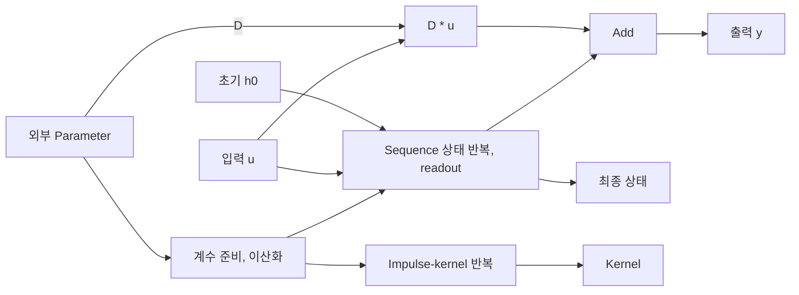

# S4

original rank-1 DPLR/NPLR recurrent, impulse-kernel core, Nfull=4, H=channels=1.

[YAML](representation.yaml) / [복원 코드](reconstructed.py) / [출처, 확인 범위](provenance.json)

## 구조도

동일한 준비 계수에서 sequence와 impulse-kernel 경로가 나뉩니다. 각 반복 내부의 상태 갱신은 하나의 노드로 요약했습니다. 주요 계산을 묶어 보여주는 요약도이며, 세부 연산과 연결은 위 YAML과 코드를 기준으로 확인합니다.

## YAML이 표현하는 내용

`representation_version: 0.3-candidate.1`, 진입점 `unit`.

raw Parameter 준비, 이산화 → sequence scan / impulse-kernel scan → direct feedthrough D 합산.

| YAML에서 볼 곳 | 복원 코드에서의 구현 |
|---|---|
| `prepare`, `f0000`… | `_prepare()`의 계수 계산 |
| `sequence_scan`, `sequence_body` | `_sequence_body()`와 시간축 `select(2,t)` |
| `f0167`, `kernel_scan`, `kernel_body` | batch 첫 항목 slice 및 `_kernel_body()`의 impulse recurrence |
| `f0170`…`f0172` | D, u direct feedthrough와 최종 y |

YAML은 연산과 연결, 속성, 공유, 상태를 기술합니다. 학습된 가중치나 실행 fixture를 저장하는 파일은 아닙니다. [공통 읽기 안내](../README.md)를 함께 참고하세요.

## 입력과 출력

| 방향 | 포트 | Shape |
|---|---|---|
| 입력 | `u` | `['B', 1, 'T']` |
| 입력 | `h0` | `['B', 1, 2, 2]` |
| 출력 | `kernel` | `[1, 1, 'T']` |
| 출력 | `y` | `['B', 1, 'T']` |
| 출력 | `h_final` | `['B', 1, 2, 2]` |

## 복원 코드 사용 조건

`model = create_model().eval()` → `kernel, y, h_final = model(u, h0)`.

p0…p6의 역할은 inv_dt, A_real, A_imag, B, C, P, D 순서입니다. 생성 시 `torch.empty`이므로 7개 값을 모두 주입해야 합니다. float64의 마지막 길이 2 축은 복소수 실수부/허수부 표현에 사용됩니다.

| YAML Parameter | Shape |
|---|---|
| `p0` | `[1, 1]` |
| `p1` | `[1, 2]` |
| `p2` | `[1, 2]` |
| `p3` | `[1, 1, 2, 2]` |
| `p4` | `[1, 1, 2, 2]` |
| `p5` | `[1, 1, 2, 2]` |
| `p6` | `[1, 1]` |

## 관련 관계

관계에서 인용하는 부품은 [복원 YAML](representation.yaml)의 최상위 정의에서 찾습니다.

관계 유형은 [관계 안내](../../relations/README.md)를 참고합니다. `?`는 추론 관계입니다.

- [LSSL → S4](../../relations/tr_049.yaml) — A, tr_049
- [S4 → H3](../../relations/tr_050.yaml) — C, tr_050
- [S4 → Hyena](../../relations/tr_053.yaml) — X?, tr_053
- [S4 → Mamba](../../relations/tr_061.yaml) — A, tr_061
