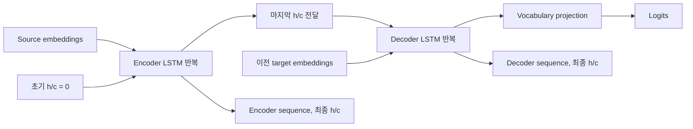

# Seq2Seq

임베딩된 입력을 받는 단층 LSTM encoder/decoder, teacher forcing 100%.

[YAML](representation.yaml) / [복원 코드](reconstructed.py) / [출처, 확인 범위](provenance.json)

## 구조도

Decoder 입력은 teacher forcing으로 공급합니다. Encoder의 마지막 h/c가 decoder 초기 상태로 연결됩니다. 주요 계산을 묶어 보여주는 요약도이며, 세부 연산과 연결은 위 YAML과 코드를 기준으로 확인합니다.

## YAML이 표현하는 내용

`representation_version: 0.3-candidate.1`, 진입점 `unit`.

source encoder scan → 마지막 h/c 전달 → target decoder scan → vocabulary projection.

| YAML에서 볼 곳 | 복원 코드에서의 구현 |
|---|---|
| `read_a`, `step_a` | source 시간축 반복과 `_step_a` |
| `handoff` | encoder 마지막 h/c를 decoder 초기 h/c로 직접 전달 |
| `read_b`, `step_b`, `invoke_b` | 정답의 이전 target embedding을 사용하는 decoder 반복 |
| `readout`, `parameters` | vocabulary projection과 10개 Parameter |

YAML은 연산과 연결, 속성, 공유, 상태를 기술합니다. 학습된 가중치나 실행 fixture를 저장하는 파일은 아닙니다. [공통 읽기 안내](../../docs/representation-guide.md)를 함께 참고하세요.

## 입력과 출력

| 방향 | 포트 | Shape |
|---|---|---|
| 입력 | `source_embeddings` | `['S', 2, 3]` |
| 입력 | `target_prev_embeddings` | `['T', 2, 5]` |
| 출력 | `logits` | `['T', 2, 7]` |
| 출력 | `encoder_sequence` | `['S', 2, 4]` |
| 출력 | `encoder_h` | `[2, 4]` |
| 출력 | `encoder_c` | `[2, 4]` |
| 출력 | `bridge_h` | `[2, 4]` |
| 출력 | `bridge_c` | `[2, 4]` |
| 출력 | `decoder_sequence` | `['T', 2, 4]` |
| 출력 | `decoder_h` | `[2, 4]` |
| 출력 | `decoder_c` | `[2, 4]` |

## 복원 코드 사용 조건

`model = create_recurrent_unit_a().eval()` → `outputs = model(source_embeddings, target_prev_embeddings)`.

a_wi/a_bi/a_wh/a_bh는 encoder, b_wi/b_bi/b_wh/b_bh는 decoder, out_w/out_b는 projection Parameter입니다. 생성자의 0은 임시값이므로 사용 전 동일 역할의 외부 값을 주입합니다. 반환값은 아래 9개 포트를 키로 갖는 dictionary입니다.

| YAML Parameter | Shape |
|---|---|
| `a_wi` | `[16, 3]` |
| `a_bi` | `[16]` |
| `a_wh` | `[16, 4]` |
| `a_bh` | `[16]` |
| `b_wi` | `[16, 5]` |
| `b_bi` | `[16]` |
| `b_wh` | `[16, 4]` |
| `b_bh` | `[16]` |
| `out_w` | `[7, 4]` |
| `out_b` | `[7]` |

[전체 모델 목록](../../README.md)

## 관련 관계

유형과 대응 범위는 [관계 안내](../../docs/genealogy-guide.md)를 참고합니다. `?`는 추론 관계입니다.

- [LSTM → Seq2Seq](../../relations/tr_004.yaml) — C, tr_004
- [RNN Encoder–Decoder / GRU → Seq2Seq](../../relations/tr_005.yaml) — X?, tr_005
- [Seq2Seq → Bahdanau Attention](../../relations/tr_007.yaml) — P, tr_007
- [Seq2Seq → Transformer](../../relations/tr_026.yaml) — A, tr_026
