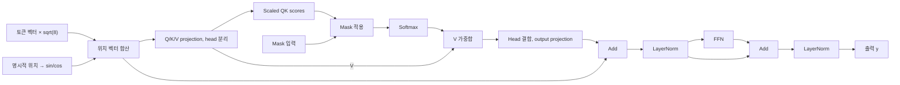

# Transformer

model dimension 8, head 2, feed-forward dimension 12의 단일 encoder block과 명시적 sinusoidal 위치 인코딩.

[YAML](representation.yaml) / [복원 코드](reconstructed.py) / [출처, 확인 범위](provenance.json)

## 구조도

두 residual 연결과 attention mask를 표시했습니다. FFN은 확장, 활성화, 축소 연산을 묶어 표시한 것입니다. 주요 계산을 묶어 보여주는 요약도이며, 세부 연산과 연결은 위 YAML과 코드를 기준으로 확인합니다.

## YAML이 표현하는 내용

`representation_version: 0.4-candidate.1`, 통합 진입점 `positioned_unit`, 기존 블록 진입점 `unit`.

토큰 스케일링과 위치 인코딩 합산 → Q/K/V projection → masked attention → projection, residual, LayerNorm → FFN, residual, LayerNorm.

| YAML에서 볼 곳 | 복원 코드에서의 구현 |
|---|---|
| `position_cast`부터 `position_add`까지 | 명시적 위치 계산, 토큰 스케일링과 합산 |
| `stage_a`, `project_a`, `partition_a` | Q/K/V linear projection과 분할 |
| `score_a`, `apply_mask`, `prob_a`, `mix_a` | scaled dot-product, mask, softmax, value 혼합 |
| `stage_b`, `expand_a`, `activate_a`, `contract_a` | feed-forward 경로 |
| `merge_a/b`, `normalize_a/b`, `state_registry` | residual, LayerNorm 및 등록된 Parameter 유지 |

YAML은 연산과 연결, 속성, 공유, 상태를 기술합니다. 학습된 가중치나 실행 fixture를 저장하는 파일은 아닙니다. [공통 읽기 안내](../../docs/representation-guide.md)를 함께 참고하세요.

## 입력과 출력

| 방향 | 포트 | Shape |
|---|---|---|
| 입력 | `words` (통합 호출), `x` (블록 호출) | `['B', 'T', 8]` |
| 입력 | `positions` (통합 호출) | `[B,T]`, int64 |
| 입력 | `mask` | `['T', 'T']` |
| 출력 | `y` | `['B', 'T', 8]` |

## 복원 코드 사용 조건

`model = create_unit_a().eval()` → `y = model.forward_with_positions(words, positions, mask)`.

`words`는 CPU float32 `[B,T,8]`의 유한한 unscaled token 벡터, `positions`는 CPU int64 `[B,T]`의 음이 아닌 위치 ID입니다. 토큰을 sqrt(8)로 확대하고 sinusoidal 위치를 더한 뒤 기존 블록으로 연결합니다. 자동 위치 번호나 padding 제거는 하지 않습니다. `mask`는 공통 `[T,T]`이며 각 query에 허용 key가 있어야 합니다. 사전 합산 입력은 기존 `model(x, mask)`로 사용할 수 있습니다.

p0/p1은 QKV, p2/p3는 attention output, p4/p5는 첫 LayerNorm, p6/p7, p8/p9는 FFN, p10/p11은 두 번째 LayerNorm입니다. 생성 시 `torch.empty`이므로 모든 값을 주입한 후 사용합니다. Boolean mask의 True 위치는 차단됩니다.

| YAML Parameter | Shape |
|---|---|
| `p0` | `[24, 8]` |
| `p1` | `[24]` |
| `p2` | `[8, 8]` |
| `p3` | `[8]` |
| `p4` | `[8]` |
| `p5` | `[8]` |
| `p6` | `[12, 8]` |
| `p7` | `[12]` |
| `p8` | `[8, 12]` |
| `p9` | `[8]` |
| `p10` | `[8]` |
| `p11` | `[8]` |

위치 연산은 [tensor 연산 확장 v1](../../docs/operator-profiles/tensor-pytorch-trig-v1.md)과 [출처](sources.yaml)에 정의됩니다.

## 관련 관계

유형과 대응 범위는 [관계 안내](../../docs/genealogy-guide.md)를 참고합니다. `?`는 추론 관계입니다.

- [ResNet → Transformer](../../relations/tr_019.yaml) — C, tr_019
- [LayerNorm → Transformer](../../relations/tr_020.yaml) — C, tr_020
- [Bahdanau Attention → Transformer](../../relations/tr_021.yaml) — I, tr_021
- [Luong Attention → Transformer](../../relations/tr_022.yaml) — C, tr_022
- [Decomposable Attention → Transformer](../../relations/tr_023.yaml) — I, tr_023
- [Structured Self-Attention → Transformer](../../relations/tr_024.yaml) — I?, tr_024
- [ConvS2S → Transformer](../../relations/tr_025.yaml) — X, tr_025
- [Seq2Seq → Transformer](../../relations/tr_026.yaml) — A, tr_026
- [QRNN → Transformer](../../relations/tr_027.yaml) — X?, tr_027
- [Transformer → Relative Position](../../relations/tr_028.yaml) — A, tr_028
- [Transformer → Transformer-XL](../../relations/tr_029.yaml) — A, tr_029
- [Transformer → Sparse Transformer](../../relations/tr_032.yaml) — A, tr_032
- [Transformer → Reformer](../../relations/tr_033.yaml) — A, tr_033
- [Transformer → Linformer](../../relations/tr_036.yaml) — A, tr_036
- [Transformer → Linear Transformer](../../relations/tr_037.yaml) — A, tr_037
- [Transformer → Performer](../../relations/tr_038.yaml) — A, tr_038
- [Transformer → Synthesizer](../../relations/tr_040.yaml) — A, tr_040
- [Transformer → Pre-LN](../../relations/tr_042.yaml) — C, tr_042
- [Transformer → Switch Transformer](../../relations/tr_044.yaml) — A, tr_044
- [Transformer → FNet](../../relations/tr_045.yaml) — A, tr_045
- [Transformer → ALiBi](../../relations/tr_047.yaml) — A, tr_047
- [Transformer → H3](../../relations/tr_051.yaml) — X, tr_051
- [Transformer → FlashAttention](../../relations/tr_054.yaml) — A, tr_054
- [Transformer → RETRO](../../relations/tr_055.yaml) — C, tr_055
- [Transformer → GQA](../../relations/tr_056.yaml) — A, tr_056
- [Transformer → RetNet](../../relations/tr_058.yaml) — X, tr_058
- [Transformer → RWKV](../../relations/tr_059.yaml) — X, tr_059
- [Transformer → Jamba](../../relations/tr_065.yaml) — A, tr_065
- [Transformer → TTT](../../relations/tr_068.yaml) — X, tr_068
- [GNMT → Transformer](../../relations/tr_069.yaml) — P, tr_069
- [E2E Memory Network → Transformer](../../relations/tr_070.yaml) — I, tr_070
- [LSTMN → Transformer](../../relations/tr_071.yaml) — I, tr_071
- [ConvS2S → Transformer](../../relations/tr_072.yaml) — C, tr_072
- [Transformer → Hyena](../../relations/tr_076.yaml) — A, tr_076
