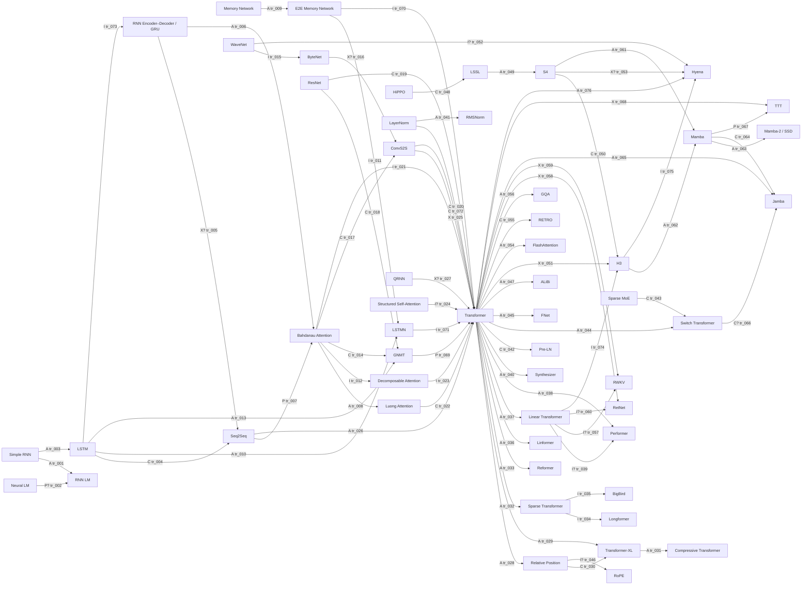

# 아키텍처 계보 관계도

카탈로그의 53개 노드와 76개 관계로 생성했습니다. A=구조/계층 계승, C=부품 계승, I=아이디어, P=병목 대응, X=대안 비교입니다. `?`는 원본의 추론 표시입니다. 화살표는 코드 실행 경로가 아닙니다.

부분 대응 60개, 선언 범위 내 대응 완료 16개입니다. [관계별 상태와 YAML](../relations/README.md)을 함께 읽습니다.

[관계 목록](../relations/README.md)
