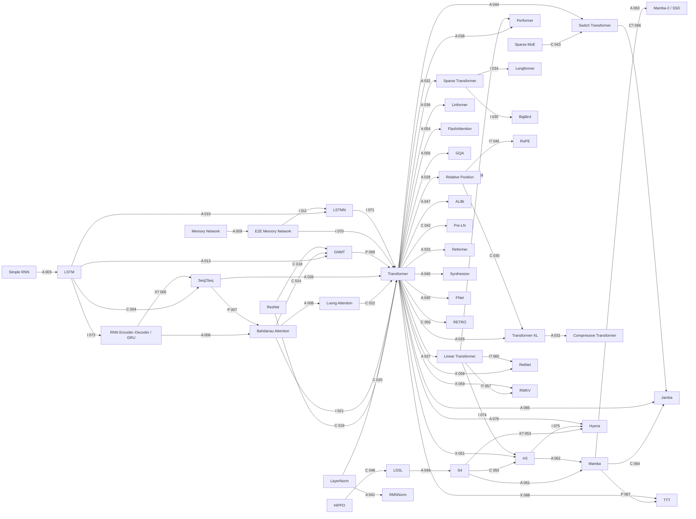

# 아키텍처 계보 관계도

카탈로그의 45개 노드와 64개 관계로 생성했습니다. A=구조/계층 계승, C=부품 계승, I=아이디어, P=병목 대응, X=대안 비교입니다. `?`는 원본의 추론 표시입니다. 화살표는 코드 실행 경로가 아닙니다.

부분 대응 48개, 선언 범위 내 대응 완료 16개입니다. [관계별 상태와 YAML](../relations/README.md)을 함께 읽습니다.

기존 연구의 범위 제한 실행 근거는 tr_037, tr_061에 보존되어 있습니다. 배포 관계에는 실행 변환기가 포함되지 않습니다.
