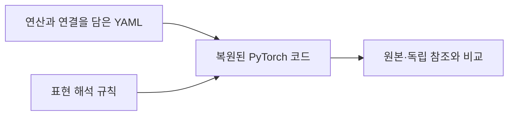

# YAML 작성 기준과 양식

모델 폴더의 README에서 범위와 입출력을 먼저 확인하고, 같은 폴더의 YAML과 코드를 나란히 읽으면 됩니다.



## YAML 작성 기준

1. **대상과 출처를 정합니다.** 원본 구현의 버전과 표현할 입출력 경계를 기록합니다. 계산에 필요한 설정은 원본에서 확인하고, 확인되지 않은 항목은 추측으로 채우지 않습니다.
2. **계산을 분해합니다.** 연산과 반복 영역을 `factors`로 나누고, 결과에 영향을 주는 축·활성화·정규화·epsilon 등의 설정을 `attributes`에 적습니다.
3. **연결을 명시합니다.** 입력에서 출력까지의 직접 연결은 `dataflow`로 표현합니다. `contains`는 포함 관계이며 나열 순서가 실행 순서를 뜻하지 않습니다.
4. **반복과 공유를 남깁니다.** 반복 축, 초기 상태, 다음 시점으로 전달할 상태를 기록하고, 같은 파라미터·객체를 재사용하는 관계와 제자리 갱신 여부를 명시합니다.
5. **구조와 실행 값을 구분합니다.** shape와 파라미터 역할은 표현에 넣고, 비교용 입력·가중치 값은 별도 실행 자료로 관리합니다. `fixture_supplied`는 외부에서 값을 공급한다는 뜻입니다.

아래 필드 표가 기본 작성 양식입니다. 새 아키텍처는 계산 형태가 가까운 기존 YAML을 출발점으로 삼아 연산·연결·상태를 바꿉니다. 버전마다 필드 구성이 다르므로 모든 모델에 하나의 템플릿을 그대로 적용하지 않습니다.

## 필드 양식

| 항목 | 의미 | 읽을 때 확인할 점 |
|---|---|---|
| `representation_version`, `operator_profile` | 표현과 연산 해석 규칙 버전 | 모델별 버전이 같다고 가정하지 않습니다. |
| `architecture_entry`, `interface` | 진입점, 입력·출력·shape·dtype | ResNet v0.2는 `interface.block`에서 시작합니다. |
| `factors`, `contains` | 연산 또는 영역과 포함 관계 | `contains` 순서는 실행 순서가 아닙니다. |
| `dataflow` | 포트 사이 직접 연결 | 실제 계산 의존관계를 따라 읽습니다. |
| `operator`, `attributes` | 연산 종류와 구체 속성 | axis, epsilon, inplace 등도 계산의 일부입니다. |
| `call`, `scan` | 영역 호출, 반복 축·상태 carry·출력 누적 | recurrent 모델은 이전 상태의 전달 방식이 중요합니다. |
| `parameters`, `resource`, `state` | Parameter, Module 공유 및 상태 의미 | shape 일치와 객체 공유는 별개입니다. |
| `state_registry` | Transformer의 Parameter 등록 계약 | 해당 후보 표현에서 사용하는 확장입니다. |

모든 YAML에 모든 항목이 있는 것은 아닙니다. 현재 ResNet은 v0.2,
Transformer는 v0.4-candidate.1, 나머지 다섯 모델은 v0.3-candidate.1입니다.
완료 상태는 모델별 범위와 평가 기준을 따른 것이며 공통 규격 전체의 일괄 승인을 뜻하지 않습니다.

## 작은 예시: shortcut 합산 후 ReLU

다음은 공개된 ResNet YAML에서 합산과 활성화 부분만 발췌한 예시입니다. `main`과 `x`는 앞선 계산에서 전달되며, 이 발췌만으로 전체 모델을 실행할 수는 없습니다.

```yaml
factors:
  merge:
    operator: add
    attributes: {inplace: true, target: main}
  activation:
    operator: relu
    attributes: {inplace: true, target: input}

dataflow:
  - [main.output, merge.main]
  - [x, merge.shortcut]
  - [merge.output, activation.input]
  - [activation.output, y]
```

대응하는 계산은 다음과 같습니다. `out`은 `main.output`이며, `self.relu`는 `inplace=True`로 준비된 ReLU입니다.

```python
out.add_(x)
y = self.relu(out)
```

`merge`는 main 결과에 shortcut을 더하고, `activation`은 합산 결과에 적용됩니다. `dataflow`가 이 순서를 정합니다. 전체 YAML의 `resource`는 앞선 ReLU와 마지막 ReLU가 같은 객체를 사용한다는 관계도 기록합니다.

[전체 YAML](../experiments/resnet/generator/input.yaml) · [복원 코드](../experiments/resnet/response_review/generated_model.py)

## 90개 아키텍처로 확장하는 순서

기존 표현을 재사용해 **YAML 작성 → 코드 복원 → 계보 연결**을 먼저 진행합니다. 복원물마다 출처와 입출력 조건을 남기고, 실행 확인 여부를 별도로 기록합니다. 이후 여러 아키텍처를 묶어 실행·출력·상태 전달을 점검합니다. 기존 7개와 동일한 상세 검증을 새 항목마다 선행 조건으로 요구하지 않으며, 아직 실행하지 않은 항목은 검증 완료로 표시하지 않습니다.

## 코드는 어떻게 복원됐나

LLM에 YAML과 표현 해석 규칙을 전달해 PyTorch 코드를 생성했습니다. 원본 구현·검사 fixture·정답 출력은 생성 입력에 넣지 않았습니다.
생성 입력과 파일 출처는 [자료 출처](artifact-provenance.md)와 [manifest](../experiments/manifest.json)에서 확인할 수 있습니다.

생성 후 원본·독립 참조와 Parameter/Buffer, 입력, 초기 상태, 실행 조건을 맞추고 출력과 중간 상태·공유·변경 동작을 비교했습니다.
S4는 slice 축과 scan 선택 표현을 합계 3줄 수정한 최종본이고, 다른 여섯 모델은 선택된 생성 코드 원문입니다.

## 실행 전에 확인할 것

`fixture_supplied`는 외부에서 Parameter 값을 공급한다는 뜻입니다. 생성자에 있는 `empty`나 임시 0만으로 원본과 같은 결과가 나오는 것은 아닙니다.
가중치 값과 학습 checkpoint는 이 자료에 포함하지 않습니다. 모델별 코드의 인터페이스와 연결된 평가 자료에서 진입점과 Parameter 역할을 확인합니다.

Linear Transformer는 외부 s/z를 제자리 갱신합니다. LSTM의 생성 클래스는 일반 Python 객체라 `.forward(...)`로 호출합니다.
Seq2Seq는 여러 출력이 담긴 dictionary를 반환합니다. 모델마다 호출·출력 방식이 다르므로 동일한 wrapper를 가정하지 않습니다.

## 검증 상태의 해석

7종 모두 지정된 핵심 계산 단위에서 해당 평가 기준을 통과했습니다. ResNet은 단일 블록,
LSTM은 T≥1, Seq2Seq는 teacher-forced core, Transformer는 단일 encoder,
Linear Transformer는 외부 q/k/v와 S/Z를 사용하는 recurrent attention이며, S4·Mamba는 각각 명시된 recurrent/scan 범위입니다.
엄격 그래프 일치와 실행 동등성은 모델별로 구분하며, 세부 기준은 [평가 기록](../results/summary.json)에 있습니다.
전체 모델, 학습·gradient 또는 모든 입력에 대한 보편적 증명을 뜻하지 않습니다.

[모델 목록](../README.md)
