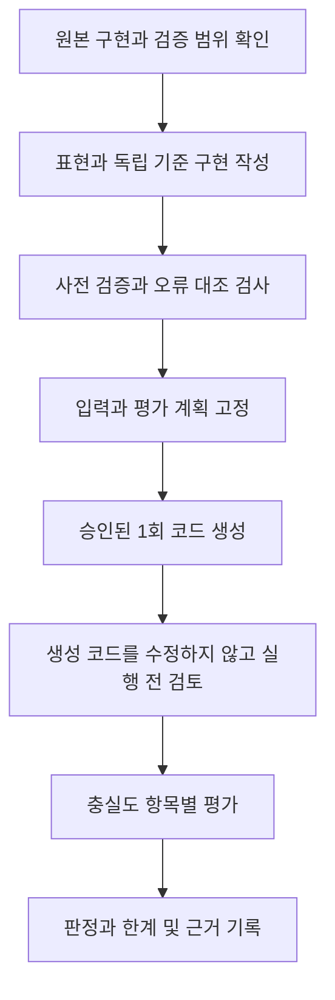

# 재구성 검증 방법

기존 실험은 아래 단계에 따라 진행했으며, 구체적인 통과 조건은 버전과 평가 범위마다 다릅니다. 이 문서는 기록된 방법을 설명하며 새로운 공통 검증기를 제안하는 문서는 아닙니다.

S4는 사전 준비까지 진행했고, Linear Transformer는 스키마 문제가 남아 있습니다. 두 사례에는 생성 후보 평가 결과가 없습니다. 생성 이후 원인을 조사한 진단용 평가도 최초에 계획한 평가와 구분합니다.

## 용어 안내

- **독립 기준 구현(reference)**: 비교 대상으로 별도로 준비한 구현입니다. 생성 후보를 정답으로 사용하지 않습니다.
- **고정 검증 조건(fixture)**: 비교에 사용할 입력, 가중치, 초기 상태 등을 미리 정한 것입니다.
- **오류 대조 예제(negative control)**: 일부러 잘못된 연산·연결·공유를 넣어 검증기가 실제 오류를 잡는지 확인하는 예제입니다.
- **사전 검증(preflight)**: 후보를 생성하기 전에 원본·기준 구현·표현·검증 절차가 준비됐는지 확인하는 단계입니다.
- **사전 고정(freeze)**: 평가 조건과 파일을 고정해 결과를 본 뒤 기준을 바꾸지 않도록 하는 것입니다.

## 항목별로 구분하는 판정

| 검증 항목 | 확인하는 질문 |
|---|---|
| 원본 근거 | 선택한 계산이 확인된 원본 구현과 명시된 범위에 대응하는가? |
| 스키마와 표현 | 선언한 버전의 규칙으로 필요한 동작을 표현할 수 있는가? |
| 구조와 데이터 흐름 | 실제 연산, 속성, 텐서 의존관계가 보존되는가? |
| 상태와 반복 | 상태 전달, 순회, 출력 누적, 경계 조건이 유지되는가? |
| 자원과 객체 | 객체 동일성, Parameter 유형, Buffer, 공유 관계가 보존되는가? |
| 수치 결과 | 고정된 조건과 허용오차 아래 중간값·최종값이 일치하는가? |
| 검증기 적용 가능성 | 후보의 의미를 바꾸지 않고 사전 고정한 검증기로 관찰·평가할 수 있는가? |

원래 실험에서는 주로 CPU float32 평가와 `rtol=1e-5`, `atol=1e-6`을 사용했습니다. 정확한 조건은 각 원본 보고서를 기준으로 합니다. 오차 0은 해당 조건에서 관찰한 결과이며, 모든 입력에서의 동등성을 증명하지는 않습니다.

## 사례별로 주의할 점

- **Transformer:** 일반 텐서에 검증용 값을 복사하면 조건부 연산 비교는 가능하지만, 빠진 Parameter 유형이 복구되거나 엄격한 Parameter 대응이 성립하는 것은 아닙니다.
- **LSTM:** T≥1에서 값이 같아도 기존 T=0 실패는 남습니다. 예외로 출력이 생성되지 않았다면 수치 오차를 측정할 수 없습니다.
- **Seq2Seq·Mamba:** 진단용 분석에서 일치해도 기존 구조 검사의 판정은 바뀌지 않습니다. 새로운 동등성 규칙은 근거와 오류 대조 검사가 필요합니다.
- **Linear Transformer:** 원본·기준 구현의 사전 검증과 생성 코드 평가는 별개입니다. 수치 일치는 Module 객체 동일성을 보장하지 않습니다.
- **ResNet 편집:** 독립적으로 편집한 기준 구현과 일치하면서 앞 연산 경로를 보존해야 합니다. 편집 전 모델과 같기만 하다면 요청한 변화가 반영됐다는 근거가 되지 않습니다.

기록된 보고서에 따르면 생성 요청에는 원본 코드, 기준 출력, 검증기를 포함하지 않았습니다. 실제 검증 코드와 당시 결과는 [실험 자료](../experiments/README.md)에 있습니다. ResNet에는 저장된 후보를 다시 검증하는 실행 경로를 추가했습니다. 모든 계열의 과거 요청과 평가를 새로 실행한 것은 아닙니다.

## 새 결과를 추가하는 방법

기존 결과를 보존하고, 새 평가는 범위·버전을 따로 기록합니다. 규칙, 입력 조건, 후보 중 무엇이 달라졌는지 명시합니다. 후보를 본 뒤 만든 검증기는 나중에 고정하더라도 사후 분석에 해당합니다. 서로 다른 범위의 평가를 하나의 성공률로 합치지 않습니다.

[프로젝트 소개로 돌아가기](../README.md)
