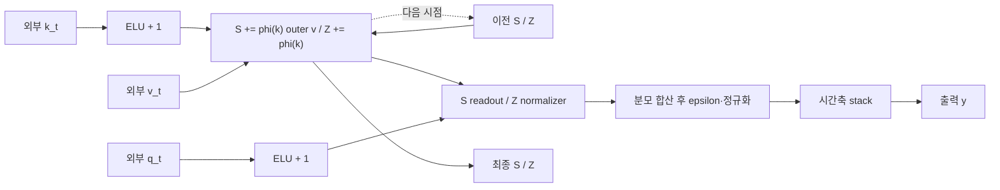

# Linear Transformer

**복원 완료 — ELU+1 recurrent attention.**

출력·S/Z 상태 전달 검증 통과.

[YAML](20261113-core-completion/representation.yaml) · [최종 코드](20261113-core-completion/generated_model.py)

## 구조도

q/k/v는 외부 입력입니다. S/Z는 제자리 갱신하며, 갱신한 상태로 현재 시점의 출력을 계산합니다. 주요 계산을 묶어 보여주는 요약도이며, 세부 연산과 연결은 위 YAML과 코드를 기준으로 확인합니다.

[평가 조건·출처](../../results/summary.json) · [전체 결과](../README.md)
