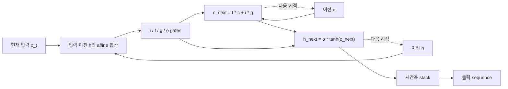

# LSTM

**복원 완료 — 단방향 LSTM core, T≥1.**

T=1/3/5 출력·상태 및 파라미터 공유 확인.

[YAML](representation.yaml) · [최종 코드](generated_model.py)

## 구조도

한 시점의 계산을 시간축으로 반복하며 같은 파라미터를 재사용합니다. 최종 h/c도 반환합니다. 주요 계산을 묶어 보여주는 요약도이며, 세부 연산과 연결은 위 YAML과 코드를 기준으로 확인합니다.

[평가 조건·출처](../../results/summary.json) · [전체 결과](../README.md)
