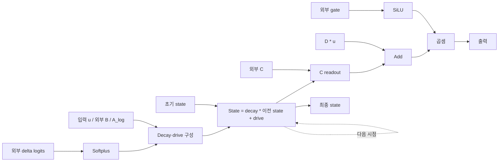

# Mamba

**복원 완료 — Selective-scan core.**

4개 fixture의 출력·시점별 상태 검증 통과.

[YAML](representation.yaml) · [최종 코드](generated_model.py)

## 구조도

B/C, delta logits, gate는 외부에서 공급됩니다. 시점별 상태 갱신 뒤 readout·D skip·gate를 적용합니다. 주요 계산을 묶어 보여주는 요약도이며, 세부 연산과 연결은 위 YAML과 코드를 기준으로 확인합니다.

[평가 조건·출처](../../results/summary.json) · [전체 결과](../README.md)
