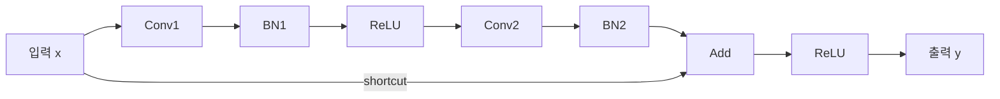

# ResNet

**복원 완료 — Identity-shortcut BasicBlock.**

7개 입력 검증 통과.

[YAML](generator/input.yaml) · [최종 코드](response_review/generated_model.py)

## 구조도

두 ReLU 호출은 같은 객체를 공유합니다. Add는 main 결과를 제자리 갱신합니다. 주요 계산을 묶어 보여주는 요약도이며, 세부 연산과 연결은 위 YAML과 코드를 기준으로 확인합니다.

[평가 조건·출처](../../results/summary.json) · [전체 결과](../README.md)
