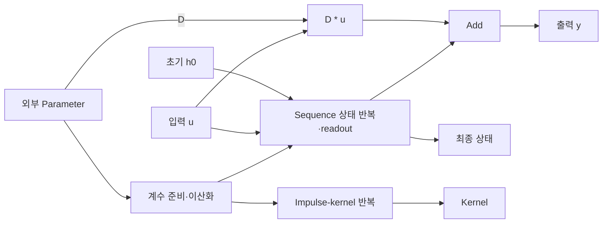

# S4

**복원 완료 — Rank-1 DPLR/NPLR recurrent·impulse core.**

엄격·실용 검증 통과.

[YAML](20261113-core-completion/representation.yaml) · [최종 코드](20261113-core-completion/repaired_model.py)

실행 시 p0…p6에 외부 Parameter를 주입해야 합니다.

## 구조도

동일한 준비 계수에서 sequence와 impulse-kernel 경로가 나뉩니다. 각 반복 내부의 상태 갱신은 하나의 노드로 요약했습니다. 주요 계산을 묶어 보여주는 요약도이며, 세부 연산과 연결은 위 YAML과 코드를 기준으로 확인합니다.

[평가 조건·출처](../../results/summary.json) · [전체 결과](../README.md)
