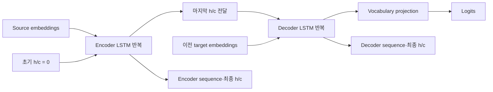

# Seq2Seq

**복원 완료 — 단일 layer teacher-forcing core.**

3개 fixture의 계산·상태 전달 검증 통과.

[YAML](representation.yaml) · [최종 코드](generated_model.py)

## 구조도

Decoder 입력은 teacher forcing으로 공급합니다. Encoder의 마지막 h/c가 decoder 초기 상태로 연결됩니다. 주요 계산을 묶어 보여주는 요약도이며, 세부 연산과 연결은 위 YAML과 코드를 기준으로 확인합니다.

[평가 조건·출처](../../results/summary.json) · [전체 결과](../README.md)
