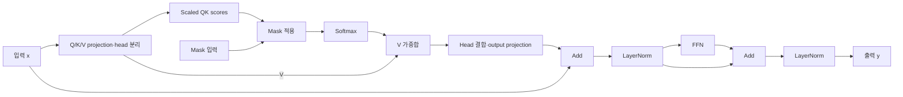

# Transformer

**복원 완료 — 단일 encoder block.**

9개 fixture의 출력·구조 검증 통과.

[YAML](20261113-core-completion/representation.yaml) · [최종 코드](20261113-core-completion/generated_model.py)

## 구조도

두 residual 연결과 attention mask를 표시했습니다. FFN은 확장·활성화·축소 연산을 묶어 표시한 것입니다. 주요 계산을 묶어 보여주는 요약도이며, 세부 연산과 연결은 위 YAML과 코드를 기준으로 확인합니다.

[평가 조건·출처](../../results/summary.json) · [전체 결과](../README.md)
