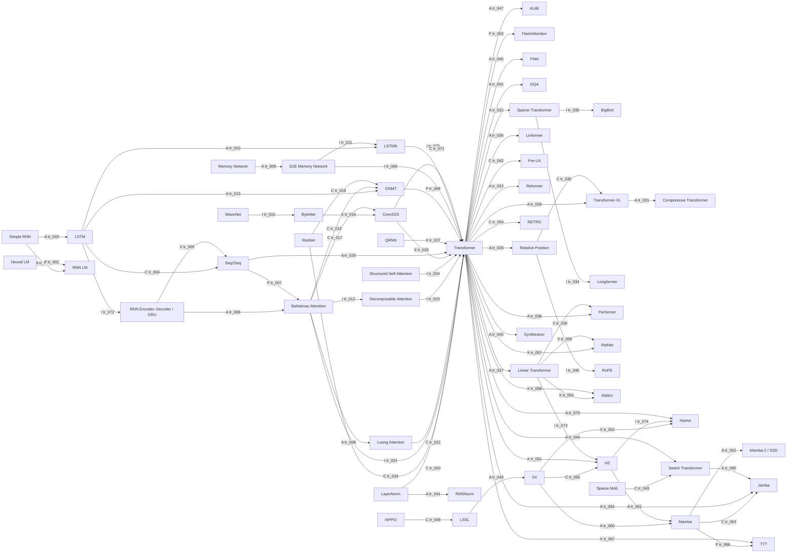

# 아키텍처 계보 관계

관계 YAML 하나가 두 모델 사이의 화살표 하나를 나타냅니다.

| 필드 | 의미 |
|---|---|
| `transition_id` | 관계의 고유 ID |
| `source_architecture` | 원본 계보에서 화살표가 시작하는 모델 |
| `target_architecture` | 화살표가 도착하는 모델 |
| `relation_type` | 두 모델 사이의 관계 유형 |
| `summary` | 관계를 설명하는 영어 한 문장 |

## 관계 유형

| 코드 | 의미 | 분류 기준 |
|---|---|---|
| A | 구조 계승 | 앞 모델의 구조나 블록을 바탕으로 새 구조를 만든다. |
| C | 부품 계승 | 앞 모델의 특정 부품을 뒤 모델에 가져다 쓴다. |
| I | 아이디어 계승 | 앞 연구의 설계 원리를 다른 방식으로 구현한다. |
| P | 병목 대응 | 앞 설계의 구체적인 한계를 뒤 설계가 완화한다. |
| X | 대안 비교 | 같은 문제를 푸는 두 방식을 비교한다. 화살표는 비교 방향을 나타낸다. |

## 관계 목록 · 75개

원안 76개에서 5개 관계의 유형을 수정하고 WaveNet → Hyena 1개를 제외했습니다.
원안 001~051은 같은 번호를 쓰고, 원안 052는 제외했으며, 원안 053~076은 현재 052~075에 해당합니다.

| ID | 출발 → 도착 | 유형 |
|---|---|---|
| [tr_001](tr_001.yaml) | Simple RNN → RNN LM | A |
| [tr_002](tr_002.yaml) | Neural LM → RNN LM | P |
| [tr_003](tr_003.yaml) | Simple RNN → LSTM | A |
| [tr_004](tr_004.yaml) | LSTM → Seq2Seq | C |
| [tr_005](tr_005.yaml) | RNN Encoder–Decoder / GRU → Seq2Seq | X |
| [tr_006](tr_006.yaml) | RNN Encoder–Decoder / GRU → Bahdanau Attention | A |
| [tr_007](tr_007.yaml) | Seq2Seq → Bahdanau Attention | P |
| [tr_008](tr_008.yaml) | Bahdanau Attention → Luong Attention | A |
| [tr_009](tr_009.yaml) | Memory Network → E2E Memory Network | A |
| [tr_010](tr_010.yaml) | LSTM → LSTMN | A |
| [tr_011](tr_011.yaml) | E2E Memory Network → LSTMN | I |
| [tr_012](tr_012.yaml) | Bahdanau Attention → Decomposable Attention | I |
| [tr_013](tr_013.yaml) | LSTM → GNMT | A |
| [tr_014](tr_014.yaml) | Bahdanau Attention → GNMT | C |
| [tr_015](tr_015.yaml) | WaveNet → ByteNet | I |
| [tr_016](tr_016.yaml) | ByteNet → ConvS2S | X |
| [tr_017](tr_017.yaml) | Bahdanau Attention → ConvS2S | C |
| [tr_018](tr_018.yaml) | ResNet → GNMT | C |
| [tr_019](tr_019.yaml) | ResNet → Transformer | C |
| [tr_020](tr_020.yaml) | LayerNorm → Transformer | C |
| [tr_021](tr_021.yaml) | Bahdanau Attention → Transformer | I |
| [tr_022](tr_022.yaml) | Luong Attention → Transformer | C |
| [tr_023](tr_023.yaml) | Decomposable Attention → Transformer | I |
| [tr_024](tr_024.yaml) | Structured Self-Attention → Transformer | I |
| [tr_025](tr_025.yaml) | ConvS2S → Transformer | X |
| [tr_026](tr_026.yaml) | Seq2Seq → Transformer | A |
| [tr_027](tr_027.yaml) | QRNN → Transformer | X |
| [tr_028](tr_028.yaml) | Transformer → Relative Position | A |
| [tr_029](tr_029.yaml) | Transformer → Transformer-XL | A |
| [tr_030](tr_030.yaml) | Relative Position → Transformer-XL | C |
| [tr_031](tr_031.yaml) | Transformer-XL → Compressive Transformer | A |
| [tr_032](tr_032.yaml) | Transformer → Sparse Transformer | A |
| [tr_033](tr_033.yaml) | Transformer → Reformer | A |
| [tr_034](tr_034.yaml) | Sparse Transformer → Longformer | I |
| [tr_035](tr_035.yaml) | Sparse Transformer → BigBird | I |
| [tr_036](tr_036.yaml) | Transformer → Linformer | A |
| [tr_037](tr_037.yaml) | Transformer → Linear Transformer | A |
| [tr_038](tr_038.yaml) | Transformer → Performer | A |
| [tr_039](tr_039.yaml) | Linear Transformer → Performer | X |
| [tr_040](tr_040.yaml) | Transformer → Synthesizer | A |
| [tr_041](tr_041.yaml) | LayerNorm → RMSNorm | A |
| [tr_042](tr_042.yaml) | Transformer → Pre-LN | C |
| [tr_043](tr_043.yaml) | Sparse MoE → Switch Transformer | C |
| [tr_044](tr_044.yaml) | Transformer → Switch Transformer | A |
| [tr_045](tr_045.yaml) | Transformer → FNet | A |
| [tr_046](tr_046.yaml) | Relative Position → RoPE | I |
| [tr_047](tr_047.yaml) | Transformer → ALiBi | A |
| [tr_048](tr_048.yaml) | HiPPO → LSSL | C |
| [tr_049](tr_049.yaml) | LSSL → S4 | A |
| [tr_050](tr_050.yaml) | S4 → H3 | C |
| [tr_051](tr_051.yaml) | Transformer → H3 | X |
| [tr_052](tr_052.yaml) | S4 → Hyena | X |
| [tr_053](tr_053.yaml) | Transformer → FlashAttention | P |
| [tr_054](tr_054.yaml) | Transformer → RETRO | C |
| [tr_055](tr_055.yaml) | Transformer → GQA | A |
| [tr_056](tr_056.yaml) | Linear Transformer → RWKV | X |
| [tr_057](tr_057.yaml) | Transformer → RetNet | X |
| [tr_058](tr_058.yaml) | Transformer → RWKV | X |
| [tr_059](tr_059.yaml) | Linear Transformer → RetNet | X |
| [tr_060](tr_060.yaml) | S4 → Mamba | A |
| [tr_061](tr_061.yaml) | H3 → Mamba | A |
| [tr_062](tr_062.yaml) | Mamba → Mamba-2 / SSD | A |
| [tr_063](tr_063.yaml) | Mamba → Jamba | C |
| [tr_064](tr_064.yaml) | Transformer → Jamba | A |
| [tr_065](tr_065.yaml) | Switch Transformer → Jamba | X |
| [tr_066](tr_066.yaml) | Mamba → TTT | P |
| [tr_067](tr_067.yaml) | Transformer → TTT | X |
| [tr_068](tr_068.yaml) | GNMT → Transformer | P |
| [tr_069](tr_069.yaml) | E2E Memory Network → Transformer | I |
| [tr_070](tr_070.yaml) | LSTMN → Transformer | I |
| [tr_071](tr_071.yaml) | ConvS2S → Transformer | C |
| [tr_072](tr_072.yaml) | LSTM → RNN Encoder–Decoder / GRU | I |
| [tr_073](tr_073.yaml) | Linear Transformer → H3 | I |
| [tr_074](tr_074.yaml) | H3 → Hyena | I |
| [tr_075](tr_075.yaml) | Transformer → Hyena | A |

전체 계보도 펼치기

