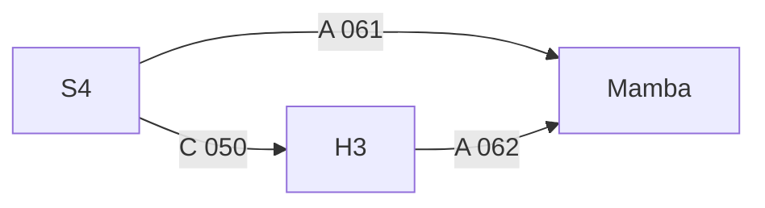

# 관계 표현 local_transition_v1

관계 YAML은 출발 모델과 도착 모델 사이에서 어떤 부품이 계승되고 무엇이 변경되는지 기록합니다. 모델 자체의 계산은 별도의 [복원 YAML](../representation/reading-rules-v1.md)이 정의합니다. 관계 YAML은 두 복원 YAML의 파일과 부품 ID를 참조합니다.

## 두 YAML의 역할

| 구분 | 복원 YAML | 관계 YAML |
|---|---|---|
| 대상 | 모델 또는 block/core 내부 | 두 모델 사이의 연결 |
| 핵심 정보 | 연산, 데이터 흐름, 파라미터, 입출력과 상태 | 관계 종류, 근거, 부품 대응, 변경과 보존 |
| 활용 | 코드 복원과 참조 비교 | 계보 설명, 부품 대응과 변경 내용 확인 |
| 확인 | 실행, 출력, 파라미터와 상태 계약 | 근거와 참조 부품의 유효성; 실행 변환이면 변경 결과도 확인 |

## 작성 근거

1. 슬라이드 또는 원본 계보 자료에서 연결 방향, ID와 관계 종류를 가져옵니다. 직접 확인과 문서 전사를 구분합니다.
2. 논문과 공식 구현에서 계승, 변경 내용을 확인합니다. 모델 이름이 비슷하다는 이유로 관계를 만들지 않습니다.
3. 실제 복원 YAML의 부품 ID에 대응시킵니다. 구현되지 않은 개념 대응은 별도로 표시합니다.
4. 구현 범위와 실행 상태를 기록합니다. 설명된 관계가 모두 자동 변환 가능한 것은 아닙니다.

`format_version`은 관계 표현의 해석 규칙을 식별합니다. 사용하는 계보 자료의 스키마와 관계 표현 형식의 대응을 명시합니다.

## 구성요소

| 필드 | 의미 |
|---|---|
| `format_version` | 관계 표현 형식 |
| `transition_id` | 관계 ID. 실행 순서가 아닌 식별자 |
| `source_architecture`, `target_architecture` | 출발 및 도착 모델 |
| `relation_type`, `inferred` | 관계 종류와 관계 자체의 추론 여부; 실행 검증 상태와 별개 |
| `evidence` | 슬라이드 페이지, 논문 절, 구현 등 근거와 확인 수준 |
| `motivation` | 변경 이유 |
| `conditions` | 적용 조건 |
| `expected_effects`, `tradeoffs` | 기대 효과와 비용, 제약; 성능 측정 결과와 구분 |
| `scope` | 포함 및 제외 범위와 출발 및 도착 복원 YAML 경로 |
| `changes` | 부품 대응, 변경 연산, 연결, 상태, 입출력 변화 |
| `preserve` | 유지할 구조 또는 계약 |
| `application` | 실행 가능한 변환인지와 적용 스크립트 |
| `validation` | 확인 범위, 결과, 참조와 보고서 |
| `unresolved` | 미해결 근거 또는 구현 문제 |

관계 종류는 사용 중인 계보 자료의 표기를 따릅니다. `A`는 구조, 특정 계층/블록 직접 계승, `C`는 부품 계승, `I`는 아이디어 계승, `P`는 병목 대응, `X`는 대안 비교입니다. 번호나 종류만으로 실행 가능 여부를 판단하지 않습니다.

## 연결 예시



직접 S4→Mamba 관계와 H3를 경유하는 관계를 함께 보존합니다. H3가 Mamba 내부의 별도 하위 모델로 포함된다는 의미는 아닙니다.

아래는 필드 설명용 예시입니다. 파일 경로와 부품 ID는 자리표시자이며 이 저장소에서 실행할 수 있는 변환 명세가 아닙니다.

```yaml
format_version: local_transition_v1
transition_id: tr_050
source_architecture: S4
target_architecture: H3
relation_type: C
inferred: false

scope:
  source_yaml: path/to/s4/architecture.yaml
  target_yaml: path/to/h3/architecture.yaml
  included: [component_correspondence]
  excluded: [whole_model_conversion]

changes:
  - before_units: [source_memory_unit]
    after_units: [target_memory_unit]
    operation: component_specialization
    mechanism: S4 계열의 상태공간 메모리를 H3의 대각 메모리 부품에 대응

application:
  executable: false
```

`source_yaml`과 `target_yaml`은 관계 파일 위치를 기준으로 해석할 수 있는 경로로 작성하고, `before_units`와 `after_units`는 각 파일에서 실제로 찾을 수 있어야 합니다. 배포 시 로컬 절대 경로를 그대로 복사하지 않고 배포된 파일 위치에 맞춥니다. 계산 내용은 복원 YAML에 두고 관계 파일에서 중복 정의하지 않습니다.

## 관계 기록과 검증의 구분

관계 작성만으로 모델 복원 성공, 출력 동등성, 학습 성능 향상을 주장하지 않습니다. 기존 모델을 관계마다 다시 복원할 필요는 없지만 새로 변경된 계산은 확인합니다.

## 부품 참조와 확인 범위

`before_units`는 출발 YAML, `after_units`는 도착 YAML에서 해석합니다. `factors.ID`는 `factors`의 키, `graph.ID`는 `graph`의 `id`, `함수/노드`는 `functions[함수].nodes`의 `id`를 가리킵니다. `parameters.ID`는 파라미터 키입니다. 경로와 ID는 해당 표현에서 실제로 존재해야 합니다.

`complete_scoped`는 선택한 핵심 계산의 대응이 연결되었다는 뜻입니다. `partial`은 주요 구조 일부가 범위 밖에 남아 있음을 뜻하며, 개념 대응과 미해결 항목을 별도로 기록합니다. 전체 모델 복원이나 자동 변환 성공을 뜻하지 않습니다.

`application.executable=false`는 공개 관계가 설명용임을 뜻합니다. `historical_execution`은 연구 공간에서 확인한 기존 실행 변환의 범위와 근거이며, 공개 변환기가 제공된다는 뜻은 아닙니다.
